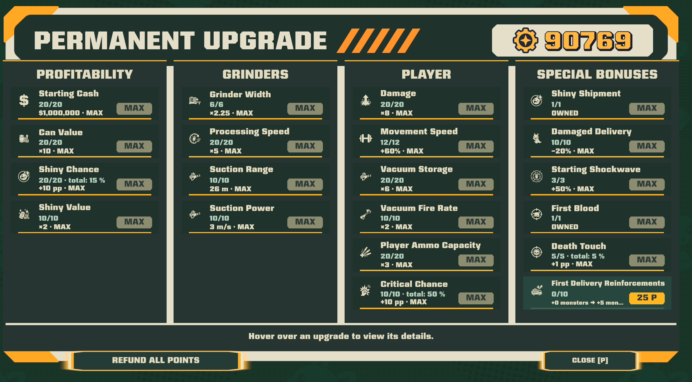
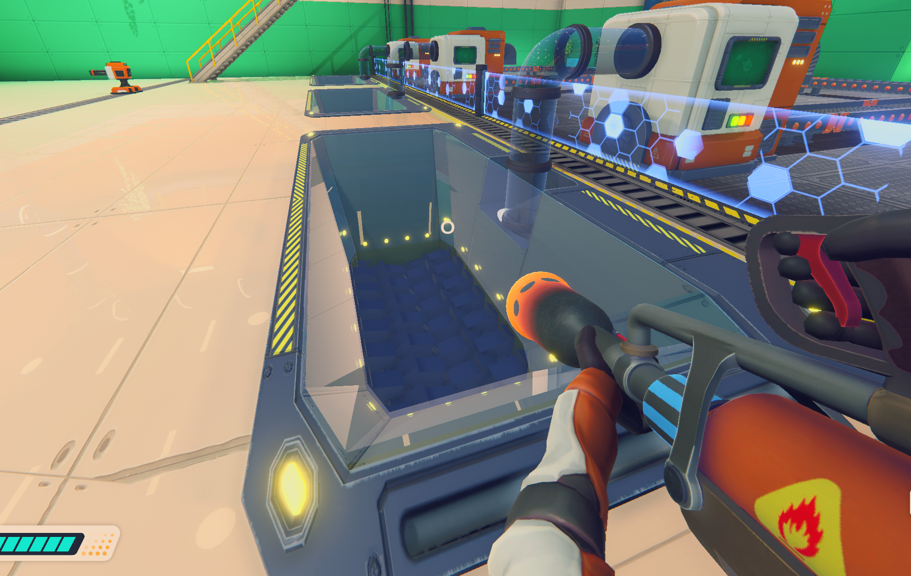
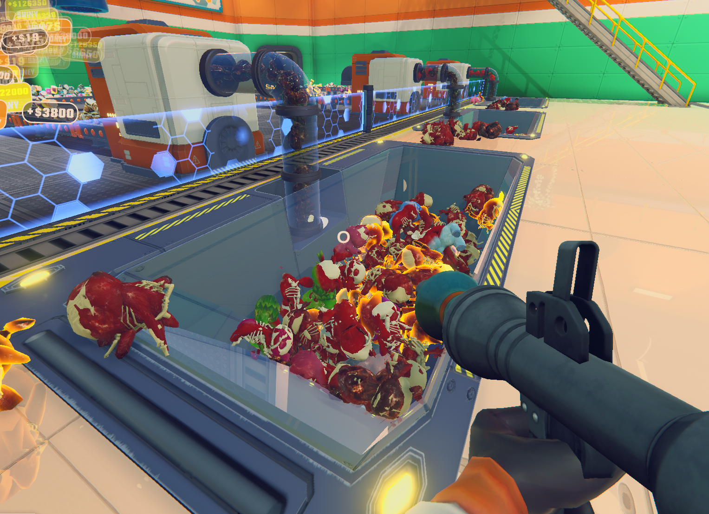
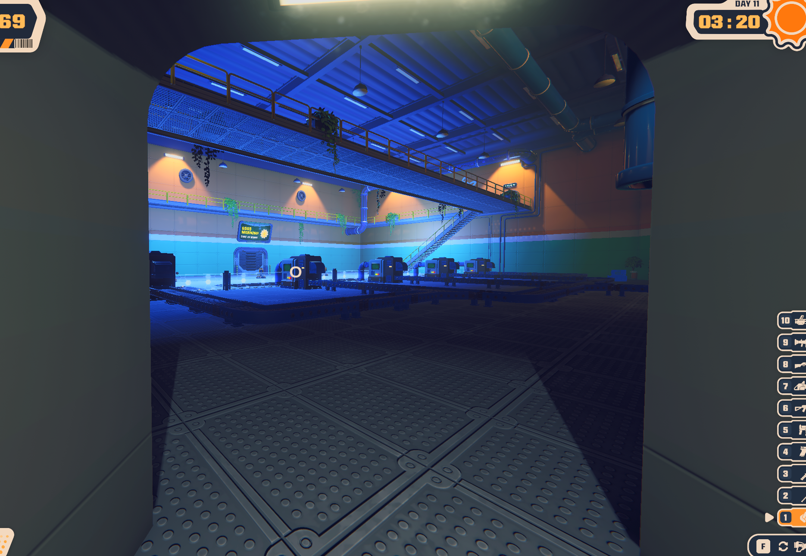
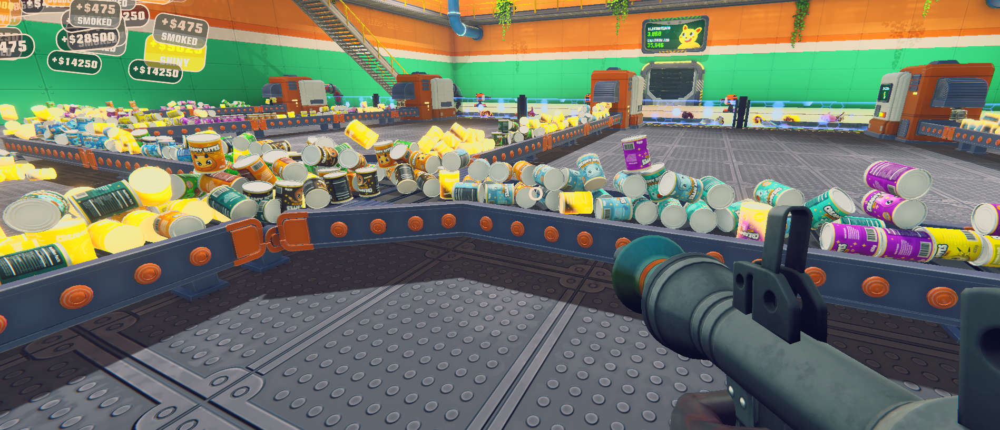

# Can ’Em All - Factory Overhaul

An experimental progression and factory automation overhaul for **Can ’Em All**.

**Current code version: 0.14.2 alpha.** Built with MelonLoader for the Windows Steam IL2CPP version of the game. The in-game assembly still uses the name **Permanent Upgrades Revamped**.

> **Source preview:** this repository contains the mod source, English documentation and core checks. A player-ready installer and downloadable binary release have not been published. The custom upgrade interface is in English; the new delivery control currently has French labels.

## What the mod does

### Expanded run skill tree

- Extend the factory to **four turrets**.
- Add turret ammunition tiers, reaching **25 times the base reserve**.
- Buy run upgrades with **Buy Maximum**: the cheapest accessible upgrade is bought first, prerequisites are reevaluated after every purchase, and buying stops when nothing affordable remains.
- Keep machines, weapons and ordinary run upgrades as purchases made during each factory run.
- Retire sweeper robots and refund their old purchases during migration.

### Permanent progression overhaul

- **20 permanent upgrades** on one screen, grouped into Profitability, Grinders, Player and Special Bonuses.
- Repeatable ranks with increasing prices, current/next effects and progress indicators.
- Starting cash up to **$1,000,000**.
- Permanent can value up to **×10**, grinder processing up to **×5**, and player damage up to **×8**.
- Separate upgrades for shiny probability, shiny value, player movement, vacuum storage, vacuum firing cadence and player ammunition.
- Preserve special effects such as Shiny Shipment and First Blood.
- Add **+5 to +50 monsters to the first delivery of each day**, across ten permanent ranks.
- Fully refund permanent purchases through the respec button.
- Prestige belongs to the save: **Continue** restores its ranks; **New Game** starts with zero ranks and creates a backup of the previous mod save.
- Keep allocated prestige after the ending, when the native game replaces its save object without loading another slot.
- English labels, descriptions, tooltips and batch controls, with English number formatting.
- Rebuild scene-owned nodes, lighting and physics caches when starting a new game or reloading the factory.



### Industrial suction and wider grinders

- Replace moving sweepers with industrial suction, purchased in **Permanent Upgrades > Grinders** through **Suction Range** and **Suction Power**.
- Pull **dead bodies only** toward active grinders, with congestion-aware routing.
- Upgrade suction to **26 m range** and **3 m/s target speed**.
- Expand grinder openings up to **×2.25 width**, including floor visuals, collisions and capture volumes.
- Resize locked grinder covers and their solid supports with the openings.

#### Final optimization - maximum-width grinders

Both screenshots show the final **Grinder Width** rank (**x2.25**), purchased in **Permanent Upgrades > Grinders**. The first view shows an empty opening; the second shows it processing a late-game load with industrial suction.





### Physics and quality of life

- Guide cans along active conveyors at their purchased speed, with lateral correction, continuous collision and reduced bouncing.
- Reduce weapon/shockwave hit impulses to **30%**, capped at **4 m/s added velocity per hit**.
- Keep manual throwing and damage values separate from this impulse reduction.
- Add blue lighting at night and restore daytime ambient lighting on the next transition.
- Restrict widened grinder damage detection to the pit rather than the nearby walking surface.
- Keep the buggy **Cold Storage** carry-over upgrade disabled.
- Open the run shop before the first day when starting or continuing a game, and return to it after selling the factory. Spend starting cash and use **Buy Maximum** before pressing **NEXT DAY** or **Space** to begin.
- Pause or resume future deliveries with a physical button inside the truck entrance. Aim at it and press **E**: green permits deliveries, red suspends them. A truck already in transit finishes its visit. The session toggle stays paused across days until resumed; reloading or starting a new game restores normal dispatch.

**Blue night lighting**



**Optimized conveyor transport**



### Diagnostics and optimization

- Reuse conveyor, collider and suction caches; avoid updating hidden upgrade cards or rewriting lighting every frame.
- During active gameplay, write performance/economy samples every **30 seconds**: frame times, mod processing costs, managed allocations, actual sales, floor cans and production backlog.
- Preserve the native payout methods and record money actually received.

See [the full feature and balance table](docs/FEATURES.md), [known issues](docs/KNOWN_ISSUES.md) and [release readiness](docs/RELEASE_CHECKLIST.md).

## Compatibility

| Component | Tested version |
| --- | --- |
| Platform | Windows, Steam |
| Steam app | 5133900 |
| Game build | 26330345 |
| Unity | 6000.2.15f1, IL2CPP |
| MelonLoader | 0.7.3 |
| Mod target framework | .NET 6.0 |
| SDK used for development and core checks | .NET SDK 8 |

Other game builds, Linux/Proton and combinations with other mods have not been validated. Use the [official MelonLoader installer](https://github.com/LavaGang/MelonLoader.Installer) and [official loader documentation](https://github.com/LavaGang/MelonLoader).

## Build from source

The game and loader assemblies are local build references. They are **not included** in this repository. The floor geometry snapshot is also generated locally and ignored by Git.

1. Install the game and the tested MelonLoader version. Launch the game once so that its IL2CPP reference assemblies are generated, then close it.
2. Install .NET SDK 8 and Python 3.11. Set up the local geometry tooling:

   ```powershell
   python -m venv .venv
   .\.venv\Scripts\python.exe -m pip install -r tools/requirements.txt
   ```

3. Build, supplying your own installation path:

   ```powershell
   .\scripts\build.ps1 -GameDir "<your Steam library>\steamapps\common\Can 'Em All" -Python .\.venv\Scripts\python.exe
   ```

The script reads the game's local `level0` asset, generates the ignored floor snapshot and builds the mod. It does not install the DLL or modify the game/save files. The resulting local DLL embeds that generated snapshot; it is not a prepared public release artifact. Public binary packaging is a separate item on the release checklist.

To run the pure C# checks without the game:

```powershell
dotnet run --project tests/CoreChecks -c Release
```

See [BUILDING.md](docs/BUILDING.md) for manual commands and dependencies.

## Installation of a locally built copy

Close the game and copy `PermanentUpgradesRevamped.dll` from the build output into the game's `Mods` directory. Launch normally. The loader log should list **Permanent Upgrades Revamped v0.14.2**.

In the shop, open **PRESTIGE** or press **P**. Press **P** or **Escape** to close the panel. **Buy Maximum** belongs to the run skill-tree tab and spends run money, not prestige points. Ammunition capacity becomes available at the next normal rearm; it does not grant free ammunition when purchased.

## Saves and removal

- The native `save.sav` is kept separate.
- On first use, the mod creates `save.pur-v1.sav` from the existing native save when available.
- Upgrade migrations refund the relevant old purchases and create a versioned backup before changing the mod save.
- The current mod save schema is **6**. The filename retains `v1` for continuity.
- Removing the DLL returns the game to its native save. Mod progression is not automatically merged back into that save.

Save directory: `%USERPROFILE%/AppData/LocalLow/LuisDev/Can 'Em All/`.

No player saves, test-point grants, loader/game binaries or generated geometry are included here.

## Status and feedback

Core balance/migration checks and local builds have been exercised. Gameplay feedback has driven several iterations, but this remains an alpha: crowded factories, conveyor junctions, widened openings and night lighting still need broader testing. No quantified FPS improvement over an unmodified game is claimed.

Please use the issue templates and include the mod version, game build, loader version, reproduction steps and relevant log excerpt. Remove personal information from logs before posting them.

The source is shared for review and development. A project license has not yet been selected. This is an unofficial community mod and is not affiliated with the game's developer or Steam.
